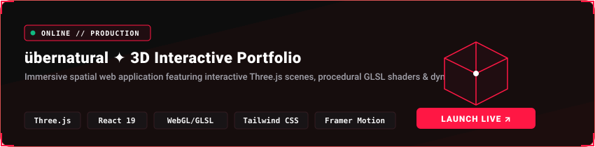

<!-- ======================================================== -->
<!-- CYBERPUNK TERMINAL HUD: DUAL THEME HERO (DARK / LIGHT)   -->
<!-- ======================================================== -->
<p align="center">
  <picture>
    <source media="(prefers-color-scheme: dark)" srcset="https://raw.githubusercontent.com/MariusBurgerDevelopment/MariusBurgerDevelopment/main/dark.svg">
    
  </picture>
</p>

<!-- ======================================================== -->
<!-- LIVE TERMINAL TYPING TELEMETRY                           -->
<!-- ======================================================== -->
<p align="center">
  
</p>

<!-- ======================================================== -->
<!-- QUICK UPLINK BUTTONS & VISITOR TELEMETRY                 -->
<!-- ======================================================== -->
<p align="center">
  <a href="https://marius-port.vercel.app" target="_blank">
    
  </a>
  &nbsp;&nbsp;
  <a href="mailto:info.mariusburger@gmail.com?subject=Collaboration%20Inquiry%20%7C%20Marius%20Burger%20Development">
    
  </a>
  &nbsp;&nbsp;
  <a href="https://za.linkedin.com/in/marius-burger-a0ba93251" target="_blank">
    
  </a>
  &nbsp;&nbsp;
  
</p>

<!-- ======================================================== -->
<!-- SUPERSONIC JET CONTRIBUTION HEATMAP                      -->
<!-- ======================================================== -->
<p align="center">
  
</p>

<p align="center">
  
</p>

<!-- ======================================================== -->
<!-- DYNAMIC GITHUB STATS & STREAK METRICS (PRIVATE + PUBLIC) -->
<!-- ======================================================== -->
<table align="center" width="100%" border="0" style="border-collapse: collapse;">
  <tr>
    <td width="50%" align="center" style="border: none; padding: 6px;">
      
    </td>
    <td width="50%" align="center" style="border: none; padding: 6px;">
      
    </td>
  </tr>
</table>

<p align="center">
  
</p>

<!-- ======================================================== -->
<!-- FEATURED PRODUCTION SPOTLIGHT                            -->
<!-- ======================================================== -->
<p align="center">
  <a href="https://marius-port.vercel.app" target="_blank">
    
  </a>
</p>

<p align="center">
  
</p>

<!-- ======================================================== -->
<!-- TECH ARSENAL // CYBERNETIC DECK                           -->
<!-- ======================================================== -->
### ⚡ Tech Arsenal // Cybernetic Deck

<p align="center">
  
</p>

<p align="center">
  
</p>

```ascii
╔═══════════════════════════════════════════════════════════════════════════════╗
║  "Code is the architecture of imagination forged into digital reality."      ║
║  — Marius Burger // Engineering Visionary Builds & Cybernetic Experiences     ║
╚═══════════════════════════════════════════════════════════════════════════════╝
```

<br />

<!-- ======================================================== -->
<!-- NEURAL UPLINK & OPERATIONS HUB                           -->
<!-- ======================================================== -->
### 🌐 Neural Uplink // Connect

<p align="center">
  <a href="https://marius-port.vercel.app" target="_blank">
    
  </a>
  &nbsp;&nbsp;
  <a href="mailto:info.mariusburger@gmail.com?subject=Collaboration%20Inquiry%20%7C%20Marius%20Burger%20Development">
    
  </a>
  &nbsp;&nbsp;
  <a href="https://za.linkedin.com/in/marius-burger-a0ba93251" target="_blank">
    
  </a>
  &nbsp;&nbsp;
  <a href="https://github.com/MariusBurgerDevelopment?tab=repositories">
    
  </a>
</p>

<br />

<!-- ======================================================== -->
<!-- CONNECT & UPLINK FOOTER                                  -->
<!-- ======================================================== -->
<p align="center">
  <sub>
    ⚡ Designed &amp; Engineered by <b>Marius Burger</b> · Built with custom animated SVGs and real-time telemetry.
  </sub>
</p>
